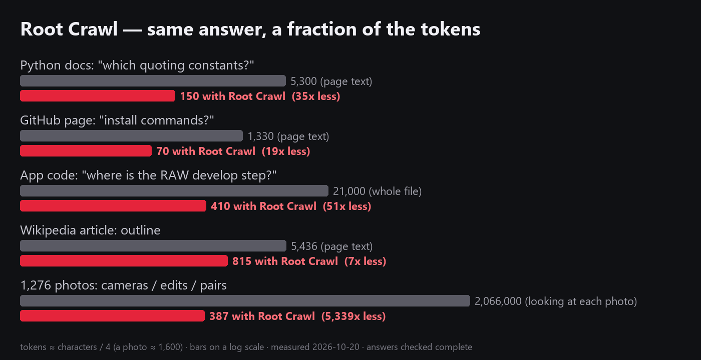

# Root Crawl — read less, know more

A Claude Code plugin that makes your AI read a **short local report instead of your files, source
code or web pages**, and then only the slices it needs. It records the tokens it saves.



```
/plugin marketplace add edshot0120-stack/rootcrawl
/plugin install rootcrawl@rootcrawl
```

Then just ask: *"what's in C:\data\survey?"*, *"where does the app save a photo?"*, *"what does this
page say about pricing?"* Claude profiles first and opens only what it needs.

| what | how | saved (measured) |
|---|---|---|
| data folders (photos, CSV/Excel, JSON, logs) | `profile` → `table` / `images` / `pairs` / `peek` | 1,276 photos: 387 tokens instead of ~2 M |
| codebases (12 languages) | `code map` → `code symbol` → `code lines` | finding one function: 410 instead of 21,000 |
| web pages | `web outline` → `section` / `find` / `links` | 7–35× vs the page text, 23–160× vs HTML |
| what it saved you | `savings` | running total of every answer |

- **Local only.** Standard-library Python 3. Nothing is uploaded, and it works offline except for web pages.
- **Your folders stay untouched.** The cache lives in your user cache folder (`%LOCALAPPDATA%\rootcrawl`
  or `~/.cache/rootcrawl`; override with `ROOTCRAWL_CACHE`), never in the data folder.
- **Tested hard.** 1,000,000-row CSVs, locked and unreadable files, Korean CP949 and other legacy
  encodings, Git Bash on Windows, and nine real websites. `python tests/smoke.py` runs the checks.

## Data folders

`profile FOLDER` reports what is in the folder:
- folders and sizes by type;
- photos: cameras, editing software, resolution, dates, and names that appear as both original and edit;
- tables: rows, columns, types, empty %, ranges and top values, plus sample rows;
- Excel sheets, the shape of JSON files, and logs (time range and the most common lines with numbers masked);
- what reading everything directly would cost.

A second run reads only the files that changed. Then take slices instead of files:

```
rootcrawl.py table sales.csv --where "region=EU and total>1000" --cols date,total --limit 20
rootcrawl.py images photos/ --make SONY --software Lightroom
rootcrawl.py pairs photos/          # originals ↔ edits, RAW ↔ JPEG
rootcrawl.py peek notes.txt --lines 40
```

Benchmarks on real folders (`bench.py`, Windows desktop, CPU):

| folder | files | size | first run | cached | report | reading directly* | saving |
|---|---|---|---|---|---|---|---|
| a Flutter app project | 515 | 17.7 MB | 3.3 s | 0.0 s | 857 tokens | 869,433 | ×1,015 |
| numpy source + test data (CSV) | 923 | 19.0 MB | 13.4 s | 0.1 s | 1,215 | 2,712,195 | ×2,232 |
| 1,479 reference photos | 1,479 | 159.3 MB | 0.9 s | 0.1 s | 320 | 2,366,400 | ×7,395 |
| an image-pair dataset (test split) | 8,735 | 94.5 MB | 24.9 s | 0.4 s | 160 | 13,976,000 | ×87,350 |

\* Text files are counted at about 4 bytes per token, and each image at about 1,600 tokens to look at. Real sessions rarely read everything, but they often read far more than they need. That gap is what these numbers show.

## Code

- `code map FOLDER` lists every file's classes, functions and methods with line numbers, most-referenced first.
- `code symbol FOLDER NAME` gives a name's definition and every use.
- `code lines FILE A B` reads just those lines.

Python is parsed with its own parser. Dart, JS/TS, Java, Kotlin, Swift, Go, Rust, C/C++/C#, PHP and Ruby are read by declaration patterns.

| codebase | files | map (default) | full map | reading all files |
|---|---|---|---|---|
| a Flutter app (`lib/`, Dart) | 74 | 2,514 tokens | 10,143 (all 946 declarations) | 161,839 |

Example: finding where the app develops a RAW shot. `code symbol lib _developNow` costs 112 tokens, then
`code lines camera_screen.dart 722 760` about 300, instead of reading the 21,000-token file.

## Web pages

`web outline URL` gives the page's outline instead of its HTML or full text: title, headings with each
section's opening, tables, forms, and the links in the content. Then use `section`, `find` (every
occurrence) or `links` as needed. A saved `.html` file works in place of a URL.

Results on nine real pages (`bench_web.py`, tokens ≈ characters / 4):

| page | outline | page text | HTML | vs HTML |
|---|---|---|---|---|
| Wikipedia article (en) | 815 | 5,436 | 52,266 | ×64 |
| Wikipedia article (ko) | 869 | 3,589 | 53,413 | ×61 |
| Python docs page | 536 | 5,471 | 24,884 | ×46 |
| MDN reference page | 1,513* | 9,093 | 61,823 | ×41 |
| GitHub repo page | 1,194 | 1,897 | 72,588 | ×61 |
| Hacker News front page | 376 | 966 | 8,491 | ×23 |
| BBC News front page | 1,513* | 2,104 | 92,250 | ×61 |
| flutter.dev docs | 428 | 2,552 | 33,566 | ×78 |
| anthropic.com/news | 677 | 804 | 108,265 | ×160 |

\* Cut at the default 1,500-token budget. Against the page's plain text, the saving is ×2–×10 on long articles and small on short pages. On short pages the outline's job is to say *where* to look.

**Limits:**
- Pages that build their content with JavaScript come back thin.
- Sites that block bots or need you to log in still need a browser tool. Root Crawl says so plainly when a site refuses it.

## Savings ledger

Every answer records what it cost and what reading the source directly would have cost. For web
pages it counts conservatively: against the page's plain text, not its HTML. `rootcrawl.py savings`
shows the total, and `savings 7` covers the last week.

## Use without Claude

```
python skills/rootcrawl/scripts/rootcrawl.py profile ./data
python skills/rootcrawl/scripts/rootcrawl.py code map ./src
python skills/rootcrawl/scripts/rootcrawl.py web outline https://example.com
```

Pillow (photo EXIF) and openpyxl (xlsx) are used when installed; everything else is the standard library.

## Where it comes from

Root Crawl is the first step of [Seed Grown](https://github.com/edshot0120-stack/seedgrown): small
local AIs that first *crawl the roots* of the data they're planted in, then learn from it. It turned
out to be useful on its own.

## Licence

**AGPL-3.0.** Using it inside a product that isn't itself released under the AGPL needs a commercial
licence; contact the author. See [LICENSE](LICENSE).

Issues and ideas are welcome, especially file formats or pages it handles badly.

---

## 한국어 요약

**Root Crawl**은 AI가 파일이나 코드, 웹페이지를 통째로 읽는 대신 **로컬에서 만든 짧은 보고서**를 먼저 읽게 하는 Claude Code 플러그인입니다. AI는 보고서를 본 뒤 필요한 부분만 꺼내 봅니다.

- **데이터 폴더:** 사진 1,276장이 약 2백만 토큰 대신 387토큰으로 요약됩니다. CSV는 조건에 맞는 행만 꺼낼 수 있습니다.
- **코드:** 함수 하나를 찾는 데 2만 1천 토큰 대신 약 410토큰이 듭니다.
- **웹페이지:** 페이지 본문보다 7~35배, HTML보다 23~160배 적게 씁니다.
- **절약량 기록:** 아낀 토큰이 누적으로 기록됩니다.
- **로컬 전용:** 표준 라이브러리 파이썬만 쓰고, 데이터는 밖으로 나가지 않으며 원본 폴더도 건드리지 않습니다.
- **한국어 환경:** CP949 파일과 한글 경로를 지원합니다.
- **라이선스:** AGPL-3.0입니다. 상업 제품에 넣으려면 별도 상업 라이선스가 필요합니다.
